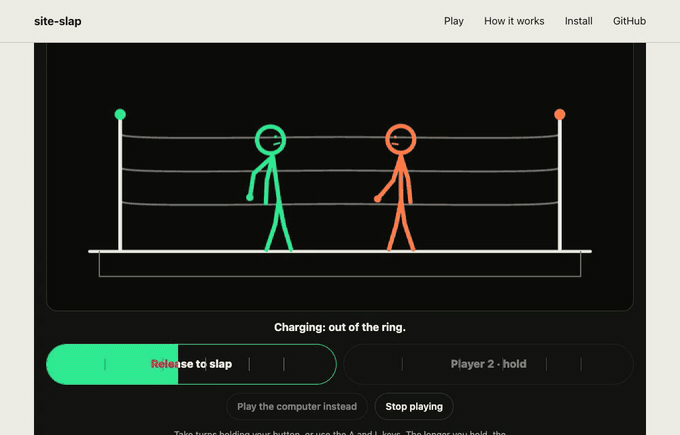
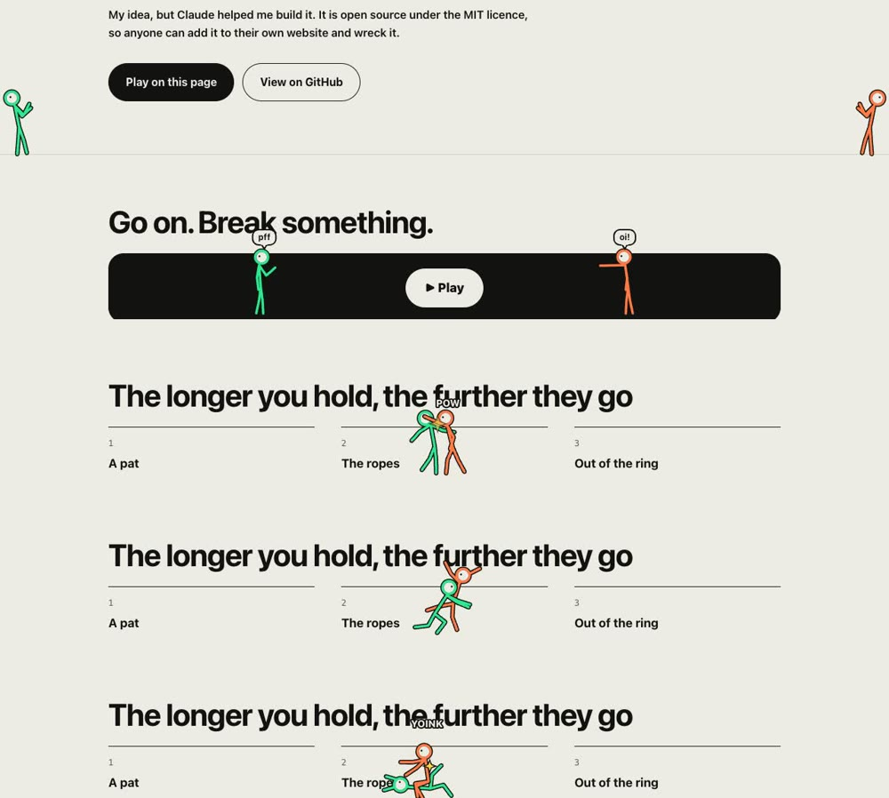
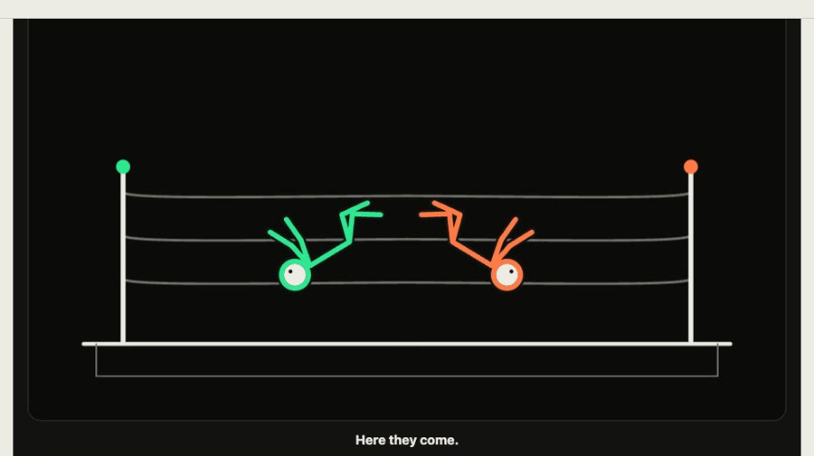
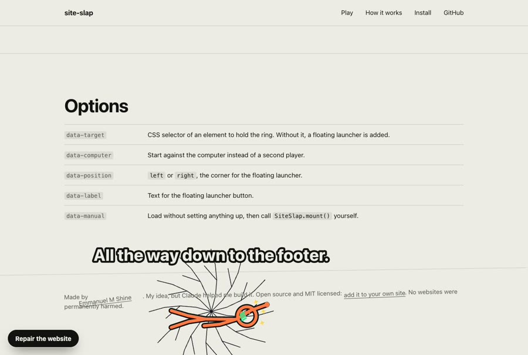
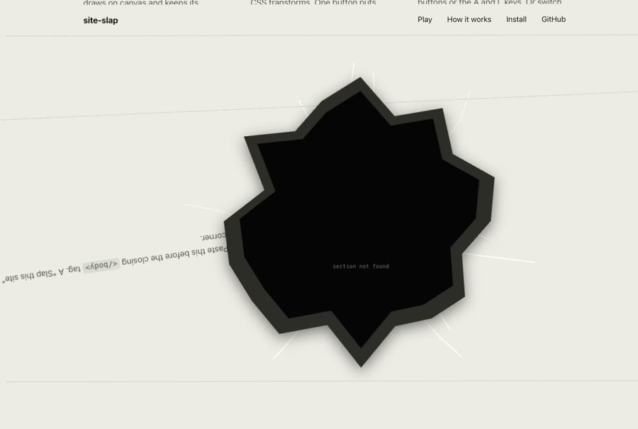
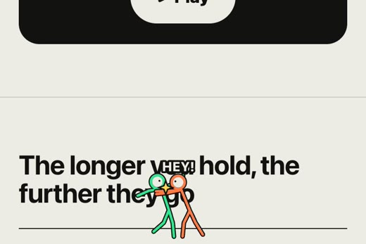

# site-slap

A two-player stick-figure slap game that wrecks the page it is installed on.

Hold a button to charge a slap. The longer you hold, the harder it lands. Hit hard enough and the loser leaves the ring, flies across your page, and breaks whatever he lands on: text scatters, sections tilt, the header falls apart, and a near-full charge punches a hole straight through the site. Fill the meter completely and you arm a bomb that blows a whole section apart.

One file. No dependencies. No build step. One button puts everything back.



**[Play the live demo](https://mupran.github.io/site-slap/)**

## What's new

**1.3: page fighters.** Two small figures now live along the bottom of the window, if you switch them on. At the top of the page they lean on opposite walls like strangers. As the visitor scrolls they notice each other, walk in and trade taunts, and by the time the ring arrives they are in a full brawl: shoves, slaps, a headlock, a leg pull, a tackle and a scrap on the floor. Press Play and they flip into the ring. On phones and tablets, tilting the device tips the uphill one over and slides him into the other.





**1.2: footer falls and smoke.** An out-of-the-ring slap lands in the page footer half the time. After a bomb, smoke rises from the crater and a haze hangs over the page until it is repaired.



**1.1: the bomb.** Fill the meter completely and the slap carries a bomb. A whole section is blown apart and a crater is left behind. Slaps also gained a wind-up spin, a freeze on contact, shock rings and a camera tilt.



## Install

Paste this before the closing `</body>` tag. A "Slap this site" button appears in the corner of the page.

```html
<script src="https://cdn.jsdelivr.net/gh/Mupran/site-slap@1.3.0/site-slap.js"></script>
```

To switch on the page fighters, add `data-fighters`:

```html
<script src="https://cdn.jsdelivr.net/gh/Mupran/site-slap@1.3.0/site-slap.js"
        data-fighters="on"></script>
```

To place the ring inside your page instead, point it at an element:

```html
<div id="ring"></div>
<script src="https://cdn.jsdelivr.net/gh/Mupran/site-slap@1.3.0/site-slap.js"
        data-target="#ring"></script>
```

You can also download [`site-slap.js`](site-slap.js) and host it yourself, or install it from GitHub with npm:

```bash
npm install github:Mupran/site-slap
```

```js
import SiteSlap from 'site-slap';
SiteSlap.mount({ target: document.querySelector('#ring') });
```

## How to play

- Two players share one screen and take turns.
- Hold your button, or hold **A** (Player 1) or **L** (Player 2). Release to slap.
- "Play the computer instead" swaps Player 2 for the computer.
- "Repair the website" restores the page.

| Hold for about | What happens |
| --- | --- |
| under 1 second | A pat |
| 1 to 1.7 seconds | Into the ropes |
| 1.7 to 2.3 seconds | Out of the ring: into a nearby section, or a long drop to the footer |
| 2.3 to 2.9 seconds | Across the page, with the page scrolling to follow |
| 2.9 to 3.4 seconds | Into the header: it tilts and its links fall off |
| 3.4 to 4.1 seconds | Through the website: a hole punched in the page |
| a completely full meter | A bomb. A whole section is blown apart, and smoke hangs over the page until it is repaired |

## Options

Set these as attributes on the script tag.

| Attribute | What it does |
| --- | --- |
| `data-target` | CSS selector of an element to hold the ring. Without it, a floating launcher is added. |
| `data-fighters` | Page fighters. `on` shows them straight away; `ask` first offers "Big fight happening below." with Watch here / No thanks. Left out, there are no page fighters. |
| `data-computer` | Start against the computer instead of a second player. |
| `data-position` | `left` or `right`, the corner for the floating launcher. Default `right`. |
| `data-label` | Text for the floating launcher button. Default "Slap this site". |
| `data-manual` | Load without setting anything up, then call `SiteSlap.mount()` yourself. |

Or from JavaScript:

```js
const game = SiteSlap.mount({
  target: document.querySelector('#ring'), // omit for the floating launcher
  colors: ['#2ee88f', '#ff7a45'],
  names: ['Player 1', 'Player 2'],
  computer: false,
  fighters: false,                         // false, true (on by default) or 'ask'
  launcherText: 'Slap this site',
  position: 'right',
});

game.open();     // start the game
game.close();    // stop it
game.repair();   // put the page back
game.destroy();  // remove the game entirely
```

## How it works

- **The ring** is a canvas. The figures are drawn from a handful of joint angles, and every animation is a tween over those angles.
- **Slow motion** is a time scale on the game clock. The camera and the hold timer run on a second, real-time clock, so the zoom stays smooth while the slap crawls.
- **Finding a target.** The game looks at the page it is on: nearby blocks for a short flight, far ones for a long flight, `<header>` or `<nav>` for the header hit, and the middle of the document for the hole.
- **The damage is real but reversible.** Elements are moved with CSS transforms only. Each element's original inline style is saved before it is touched and restored on repair, so nothing is removed from the page and layout never changes.
- **Isolation.** The interface lives in a shadow root, so your CSS cannot restyle it and its CSS cannot leak into your page.

## The page fighters in detail

- **Scroll-driven.** With an inline ring, the fight builds as the ring scrolls into view. With the floating launcher, it builds toward the foot of the page.
- **They walk, they do not slide.** Legs are driven by the distance covered, so feet stay planted. Scroll fast and they jog.
- **A choreographed brawl.** Each move is a pose for two figures on a small rig with knees and elbows. Dust only covers them for a moment when it peaks.
- **Tilt.** On phones and tablets the uphill fighter loses his footing, goes down and slides. Tilting the other way slides the whole scrap across. iPhones ask the visitor to allow motion first.
- **Out of the way.** They sit on a strip along the bottom edge, never block clicks, and a "Page fighters" switch in the game turns them off. The choice is remembered.



## Good to know

- It respects reduced-motion settings: with those on, hard hits stay in the ring and nothing on the page moves.
- It assumes the window is what scrolls. On pages that scroll inside a container, flights still work but the page will not follow them.
- Frameworks that re-render may undo damage on their own. Nothing breaks, the wreckage just tidies itself.

## Licence

MIT. Made by [Emmanuel M Shine](https://www.mupranthetechguy.com). My idea, but Claude helped me build it.
